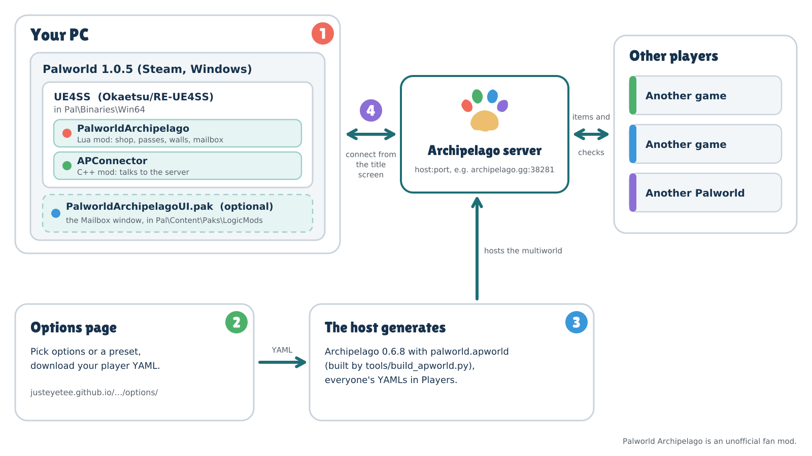

# Palworld Archipelago Randomizer

An [Archipelago](https://archipelago.gg) multiworld randomizer for Palworld. It is playable and being playtested; the
World Tree goal and alpha checks are not tested in game yet.

Palworld's Technology tree (levels 2 and up) becomes an Archipelago shop whose cards show what each purchase sends to
the multiworld, with captures, alphas, towers, fast-travel points and levels as further checks and Area Passes gating
progression. It runs as a UE4SS mod inside the player's own game: a Lua core plus a C++ part that connects to the
Archipelago server. Targets Palworld 1.0.5 and Archipelago 0.6.8. To install and connect, follow the setup guide,
`apworld/palworld/docs/setup_en.md` (also the Setup Guide on an Archipelago site's Palworld page).

<picture>
  <source srcset="art/readme/install-diagram-dark.svg" media="(prefers-color-scheme: dark)">
  
</picture>

`apworld/palworld/` is the APWorld: options, items, locations and logic, with `game_data.py` generated from the game's
tables by `tools/gen_apworld_data.py`. `mod/PalworldArchipelago/` is the UE4SS Lua mod (its `Scripts/ap_data.lua` is
generated from the APWorld by `tools/gen_lua_data.py`), and `mod/test/` its test harness (`tools/lua_harness.sh`).
`cppmod/APConnector/` is the UE4SS C++ mod that connects to the Archipelago server; CI builds it on Windows and
packages it with the Lua mod.

`mod/PERF-PROBE.md` explains the test builds' performance probe (`perf_log=1`) and how to read its log lines.
`logicmod/` holds the optional PalworldArchipelagoUI Blueprint pak (the Archipelago Mailbox's own window), built in
the community Palworld Modding Kit; its README has the steps. `spike/` holds the feasibility probes (a server-side probe and the client tech-shop probe). `tools/` reads Palworld's
own data through the probe and turns it into the facts the randomizer needs; `data/` holds those facts (areas, where
each Pal can be obtained). Raw dumps of Pocketpair's game tables are not distributed here: they are Pocketpair's, not
covered by this repository's licence, and are regenerated from your own copy of the game with the probe's
`dumptable` and `dumpactors` commands.

Most of its code, tools and documentation are written by Claude, an AI model made by Anthropic, at JustEyeTee's
direction.

## Options page

`docs/options/` is a page where a player picks the Palworld options (or a preset) and downloads a player YAML for
Archipelago. Archipelago's website only has options pages for the worlds it ships, so this world has its own. Once
GitHub Pages serves the `docs` folder of `main`, it is at
https://justeyetee.github.io/Palworld-Archipelago-Randomizer/options/. The YAML it writes is the one Archipelago's
template generator writes for the same choices.

Its YAML (like Archipelago's templates) requires the world's version, so the host's `.apworld` must be built with
`tools/build_apworld.py`, which adds the manifest fields Archipelago reads the version from:

    AP_DIR=../archipelago-0.6.8 ../archipelago-0.6.8/.venv/bin/python tools/build_apworld.py palworld.apworld

A plain zip of `apworld/palworld` loads as version 0.0.0 and Archipelago refuses the page's files. The test scripts
build their `.apworld` with it too.

The page reads `docs/options/options.json`, which is written from the APWorld's options, groups and presets. After
changing `apworld/palworld/options.py` (or the world version), regenerate it with the Archipelago venv:

    AP_DIR=../archipelago-0.6.8 ../archipelago-0.6.8/.venv/bin/python tools/gen_options_page.py

`tools/test_options_page.py` checks that `options.json` is current, that the page's YAML for the defaults and each
preset is the same as Archipelago's own templates, and that each one generates a beatable seed (its docstring has
the command; it runs the page's JavaScript in QuickJS, from the `quickjs` pip package). To try the page locally,
serve the folder (`python3 -m http.server -d docs`) and open http://localhost:8000/options/.

## Licence

CC0 1.0 Universal (see LICENSE). The artwork in `art/` (the logo and the shop card icons) is CC0 too and was made
by Claude (Opus 5.5) at JustEyeTee's direction. The wordmark's letters are outlines of the Lilita One typeface by Juan
Montoreano, under the SIL Open Font License 1.1 (`art/FONT-LICENSE-LilitaOne-OFL.txt`); the options page ships the
font file itself (`docs/options/LilitaOne-Regular.ttf`, with its licence in `docs/options/LilitaOne-OFL.txt`). The
README graphics in `art/readme/` and the options page's header and styling were made by Claude (Opus 5.5) too.

Palworld Archipelago is an unofficial fan project. It is not affiliated with or endorsed by Pocketpair, Inc. or the
Archipelago project. Palworld is a trademark of Pocketpair, Inc.
